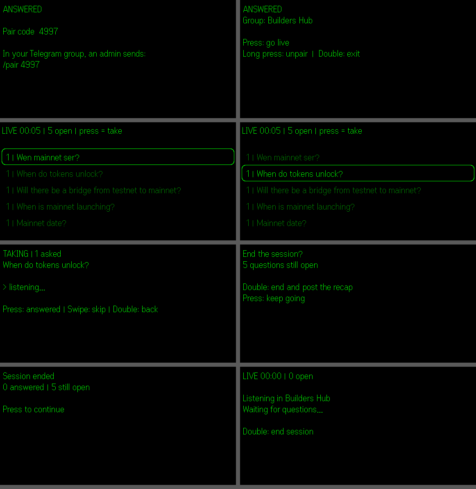
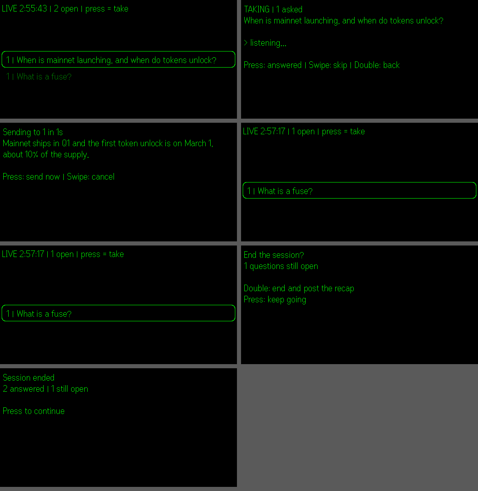

# Answered

Answer a Telegram audience out loud, once. Answered runs on Even Realities G2 glasses:
questions from a Telegram group are merged and ranked on the display, the host takes one
with a ring or temple press and answers naturally, and the bot replies in the group to
everyone who asked. A question that was only talked around stays open.

Built for the [Heads Up: Even Realities Hackathon](https://dorahacks.io/hackathon/even-realities/detail)
(Track 01 · Messaging & News). The build plan is in [docs/PHASES.md](docs/PHASES.md).

> Status: **phases 0-6 of 0-7 done**: pairing, glasses screens, question ranking, spoken answers,
> Telegram replies and the pinned recap all work end to end. Results: [docs/SCORECARD.md](docs/SCORECARD.md).



A real run on the live server (26 Nov): paired glasses take a two-part question, the host answers it
out loud, the bot replies in the group, and the session ends with a pinned recap.



## Using it

1. Add **@answereddbot** to your Telegram group as an admin (Pin messages, Delete messages).
2. Open Answered on G2. The glasses show a code; an admin sends `/pair 4821` in the group.
3. Press to go live (or send `/live`). The bot opens the Q&A in the group.
4. The queue on the glasses ranks questions by how many people asked. Scroll with the ring,
   press to take one, and answer out loud.
5. When your answer really answers it, the glasses show "Sending to N in 3s" (press = now,
   swipe = cancel) and the bot replies once, threaded, mentioning everyone who asked.
   A question you only talked around stays open.
6. Double-press twice to end.

| Screen | Press | Swipe | Double | Long press |
|---|---|---|---|---|
| Pair | - | - | exit | - |
| Lobby | go live | - | exit | forget pairing |
| Queue | take selected | move selection (on the glasses) | end session (asks first) | flag as spam (deletes it) |
| Taking | mark answered | skip | back to the queue | - |
| Sending | send now | cancel | cancel | - |
| End? | keep going | keep going | end | - |

## Layout

```
apps/glasses     G2 app (Vite + TypeScript + Even Hub SDK), from evenhub-templates/minimal
apps/server      Fastify server: Telegram webhook, glasses WebSocket, pipeline (later phases)
packages/protocol  Message types shared by both over WS /ws/glasses
docs/            Build phases and notes
```

The glasses app is a thin client: it streams mic audio (PCM s16le, 16 kHz, mono) and
gestures to the server and renders the screens the server pushes. No API keys ship in the app.

## Run locally

Requires Node 22+ and pnpm 10.

```bash
pnpm install
cp apps/server/.env.example apps/server/.env        # GLASSES_DEV_TOKEN=dev is enough for phase 0
cp apps/glasses/.env.example apps/glasses/.env.local

pnpm dev:server                                     # http://localhost:8787
pnpm dev:glasses                                    # http://localhost:5173
pnpm --filter @answered/glasses simulate            # Even Hub simulator
```

The simulator should show `ANSWERED phase 0` with a live mic level; press, swipe and
long-press show up as "Last input", and double-tap exits.

Without glasses or a simulator, check the socket with
`GLASSES_DEV_TOKEN=dev pnpm --filter @answered/server ws-smoke`.

### Telegram webhook

1. BotFather: `/newbot`, `/setprivacy` → Disable, `/setjoingroups` → Enable; add the bot to a test
   supergroup as an admin (needed for reaction updates).
2. Deploy the server behind HTTPS and set `PUBLIC_URL`, `TG_BOT_TOKEN`, `TG_WEBHOOK_SECRET`.
3. `pnpm --filter @answered/server set-webhook`, then send `/ping` in the group.
4. An admin sends `/live` to start a Q&A and `/end` to close it.

### Deploying on Railway

One service from this repo; Railway runs `pnpm start` (the server). Add a volume mounted at
`/data`, set `DATABASE_URL=file:/data/answered.db`, and copy the variables from
`apps/server/.env.example`. Generate a public domain and use it as `PUBLIC_URL`.

### Packaging

`pnpm --filter @answered/glasses ehpk` builds `answered.ehpk` from `apps/glasses/.env.production`
(the deployed server, no dev token). The deployed server's origins must be in `apps/glasses/app.json`
→ `network.whitelist` (both the `https://` and the `wss://` origin); anything else is blocked on the device.
(Not `pnpm pack`: that is pnpm's own npm-tarball command.)

### Headless simulator (Linux CI or cloud containers)

The simulator needs WebKitGTK, a display and an audio input:

```bash
apt-get install -y libwebkit2gtk-4.1-0 xvfb xauth pulseaudio libasound2-plugins
pulseaudio --start --exit-idle-time=-1
pactl load-module module-null-sink sink_name=virt && pactl set-default-source virt.monitor
printf 'pcm.!default { type pulse }\nctl.!default { type pulse }\n' > ~/.asoundrc
xvfb-run -a npx evenhub-simulator --automation-port 9898 --aid alsa:default http://localhost:5173
paplay --device=virt some-speech.wav                 # feeds the simulated glasses mic
curl localhost:9898/api/screenshot/glasses -o glasses.png
```

## Demo audience

Bots never see other bots' messages, so the demo audience has to be real Telegram accounts.

```bash
cd tools/seed && cp .env.example .env     # TG_API_ID / TG_API_HASH from https://my.telegram.org
pnpm --filter @answered/seed login        # once per account, on your machine; prints a session string
pnpm --filter @answered/seed seed -- --dry-run   # the schedule
pnpm --filter @answered/seed seed         # after /live: posts the 40-message burst
pnpm --filter @answered/server host-sim   # plays the host (takes the top question, speaks fixtures/host.wav)
```

## Tests

```bash
pnpm test        # protocol, webhook secret, glasses socket, outbox limits, /live and /end flows, database
pnpm typecheck
```

## What existed before 23 Nov

The official `evenhub-templates/minimal` template (index.html, Vite and TS config), the
Even Hub SDK, CLI and simulator, and open-source libraries (Fastify, grammY, ws, zod).
Everything else in this repository was written during build week.

## License

MIT
