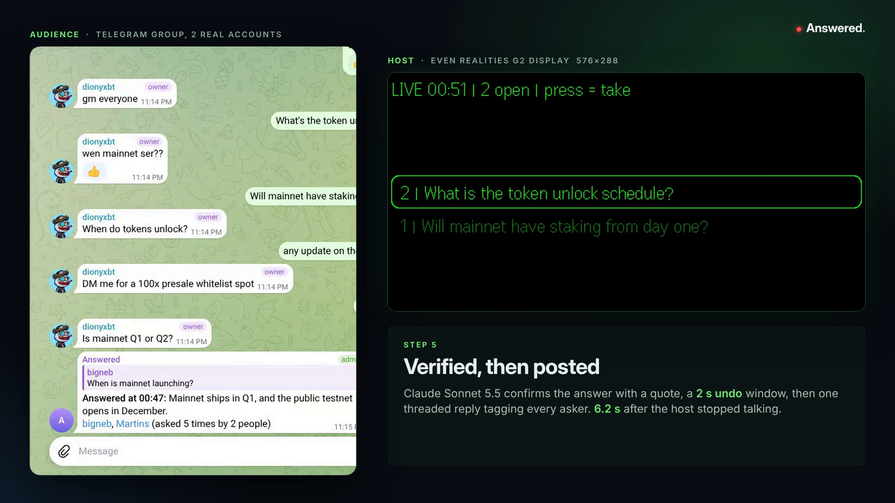

## The problem

Crypto and creator communities run their AMAs and community calls in Telegram. During a live call the chat explodes:
the same question gets asked a dozen different ways, mixed in with "gm", repeats and scam links. The host is talking,
so they can't read it. They scroll, miss most questions, answer the loudest one, and the people who asked never learn
that their question was answered.

## What Answered does

Answered puts the Telegram audience on the host's **Even Realities G2** display and closes the loop automatically:

1. **Pair in seconds.** The glasses show a 4-digit code; a group admin sends `/pair <code>` to the bot. No accounts, no phone app.
2. **Go live with one ring press.** The bot posts an opening message in the group.
3. **Questions, not noise.** Claude Haiku 5.5 reads every message, drops chatter and spam, and merges repeats.
   Five ways of asking "when mainnet?" become one line on the HUD, ranked by how many people asked.
4. **Take a question and just answer it out loud.** The G2 microphone streams to Deepgram Nova-3.
5. **Verified before it's posted.** Claude Sonnet 5.5 checks that the spoken answer really answers the question, and
   it must quote the transcript. A talked-around answer ("we're still working through the details") stays open.
6. **One threaded reply, everyone tagged.** After a 2 s undo window, the bot replies to the original message with a
   summary and @mentions every person who asked. About 6 s from the end of speech to the post, including the undo window.
7. **End with a recap.** A double press ends the session; the recap (answered, still open, with timestamps) is posted and pinned.

Ring/temple input on the glasses: press = take / answered, swipe = scroll / skip, double press = put back / end, long press = flag spam.

## Demo

Video (2:51): one continuous take on the deployed server, with two real Telegram accounts. The Telegram group is on the
left and the G2 display (Even Hub simulator) is on the right.

## How it works

- **Glasses app**: Even Hub SDK 0.0.16 (TypeScript + Vite WebView), native list container for the queue, text containers
  for the other screens, `audioControl` for the G2 mic, packaged as `.ehpk`.
- **Server**: Node.js, Fastify 5 + WebSocket, SQLite, deployed on Railway.
- **Telegram**: grammY bot (webhook): threaded replies, mentions, reactions as votes, pinned recap, rate-limited outbox.
- **AI**: Claude Haiku 5.5 (question detection, spam, clustering), Claude Sonnet 5.5 (answer judge with a quote check),
  Deepgram Nova-3 streaming speech-to-text with keyterm boosting.

## Results (from the repo's scorecard, 3 runs)

- 100% of questions detected (26 labelled), 92–100% of duplicates merged correctly, **0 false merges**, spam caught 2 of 2.
- Answer judge: **30 of 30** cases correct, 0 false "answered", 0 real answers missed.
- Latency: median **6.1 s** from the end of speech to the posted reply (with the undo window).

## Hackathon

- **Track 01 · Messaging & News.** Also eligible for **Best Telegram integration** and the Grand Prize.
- Built during the hackathon; the README's "What existed before 23 Nov" section has the details.
- Privacy: audio is never stored; raw messages and transcripts are deleted when a session ends.
- Feature requests for Even Realities are in the README (list updates without rebuilds, selection events, text emphasis,
  on-device VAD, headless simulator).
- Tested end to end in the Even Hub simulator against the live server and real Telegram groups; no physical G2 was available to us.

**Try it:** install `release/answered.ehpk`, add [@answereddbot](https://t.me/answereddbot) to a Telegram group as an admin, and send `/pair <code>`.
